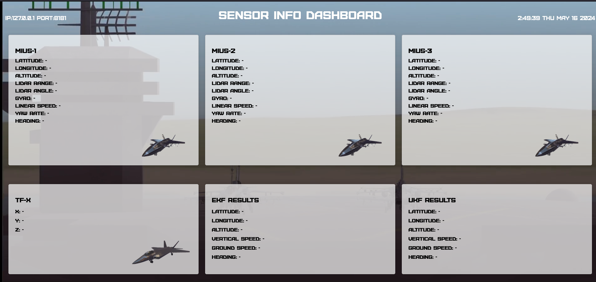
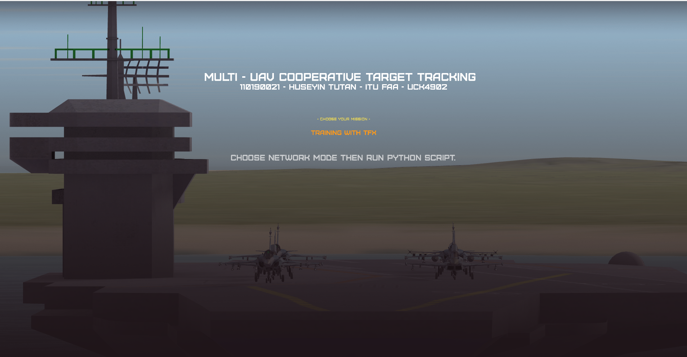
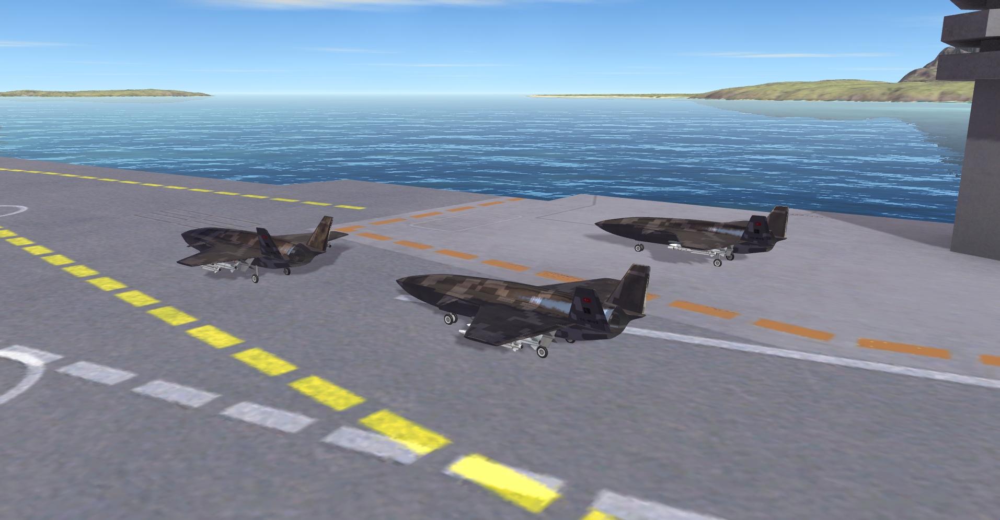
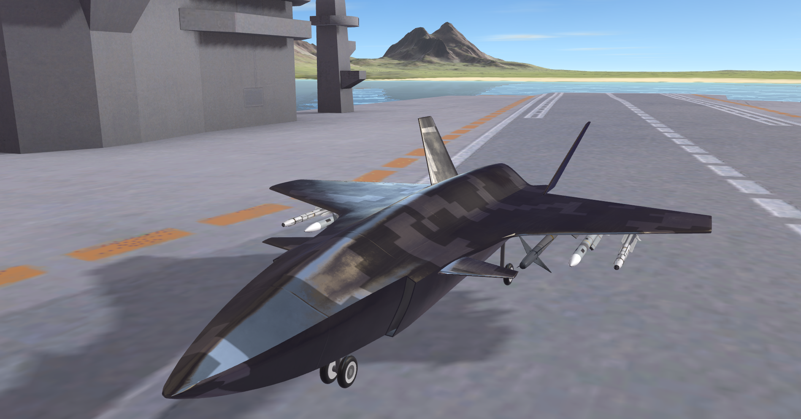
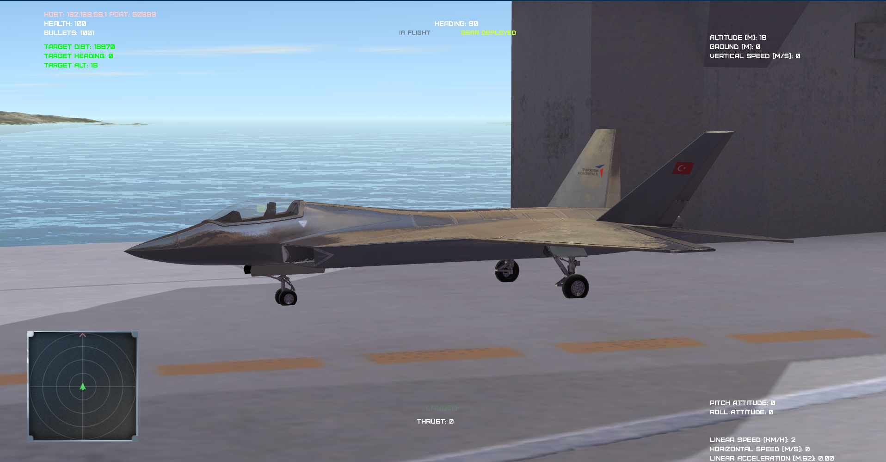
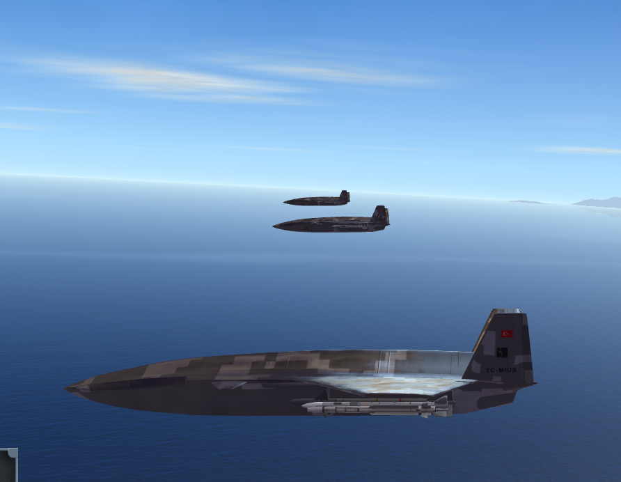

# Multi-UAV Cooperative Target Tracking

## Overview
A sophisticated simulation environment for cooperative target tracking using multiple Unmanned Aerial Vehicles (UAVs). This project was developed as a graduation thesis at Istanbul Technical University's Aeronautical Engineering Department (UCK4901-UCK4902).

> Built using [Dogfight Sandbox](https://github.com/harfang3d/dogfight-sandbox-hg2)



## Project Description
The project focuses on enhancing target tracking accuracy by implementing a collaborative filtering approach that combines sensor data from multiple fixed-wing UAVs. The simulation features:

- 3 Friendly UAVs and 1 Enemy Fighter Jet
- High-frequency sensor data collection:
  - GPS
  - IMU
  - LIDAR
- Real-time data visualization through a web-based dashboard
- Cross-platform compatibility (Windows, Linux, macOS)

## Features
- Real-time sensor data processing
- Web-based monitoring interface (Flask)
- UDP socket communication
- Multi-vehicle coordination
- Advanced filtering algorithms

## Technical Requirements

### Prerequisites
- Python 3+
- Flask
- harfang==3.2.5
- tqdm
- pyproj
- pypubsub
- filterpy

### Installation

1. Clone the repository
```bash
git clone https://github.com/huseyintutan/Multi-UAV-Cooperative-Target-Tracking
```

2. Install dependencies
```bash
# Windows
0-install-requirements.bat

# Linux/MacOS
pip install -r requirements.txt
```

## Running the Simulation

1. Start the main simulation
```bash
# Windows
1-start.bat

# Linux/MacOS
python main.py
```

2. Press any key when the following screen appears:


3. Launch the network client
```bash
python client_sample.py
```

4. Start the dashboard server
```bash
python server.py
```

5. Access the dashboard
Open your web browser and navigate to:
```
http://127.0.0.1:8181
```

## Visual Showcase

### Landing Operations


### MIUS UAV


### TFX Fighter


### Formation Flight


## Contributing
Contributions are welcome! Please feel free to submit a Pull Request.

## License
This project is licensed under the MIT License - see the LICENSE file for details.

## Acknowledgments
- Istanbul Technical University Aeronautical Engineering Department
- Dogfight Sandbox Development Team
- All contributors and advisors

---
*This project is part of an academic study. For academic inquiries or collaborations, please open an issue or contact the repository owner.*